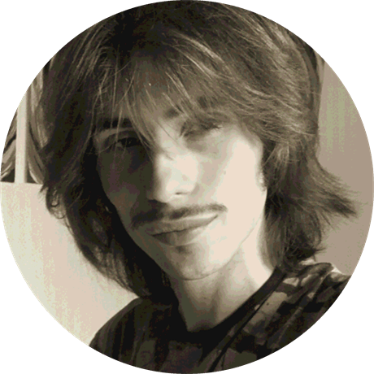
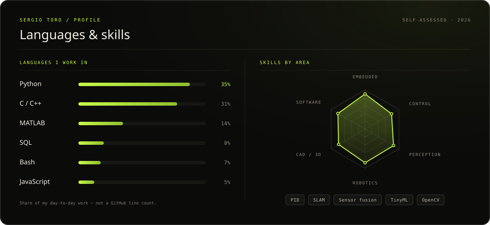

  

<h1 align="center">Hey, I'm Sergio</h1>

  Robotics &amp; Automation Engineering student at <strong>EINA · University of Zaragoza</strong>, 
  on exchange in Mechanical Engineering at <strong>Nanjing Tech University</strong>. 
  For the last 3+ years I've been building autonomous mobile robots end-to-end — 
  embedded firmware and the control code that ties it together.

  
  
  

Zaragoza, ES ↔ Nanjing, CN 

## Tech stack

  
  
  
  
  
  
  
   
  
  
  
  
  
  

## Languages & skills

  

## Selected projects

- **JRG-25 → JRG-26 — autonomous mobile robot** (10th ASTI Robotics Challenge / ARC 2026, team w/ *Carlos Rios, Diego Lopez, Martin Rincon*) — finalist and EINA-Proyecta winner with JRG-25; its 2026 evolution, JRG-26, won the **Best Performance Award (1st prize)**. Contains Custom PCB, ToF/IMU/encoder integration, embedded C++ with PID + anti-windup, differential odometry, FSM, layered firmware with CI and a Python/Tkinter GUI.
- **S.P.I.T. — early wildfire prevention** (WED 2026, team *InnoviZar*) — *Theorically Designed* -  UAV RGB + thermal sensing, on-board TinyML inference, PLC control with pressure/flow feedback and hydraulic sizing.
- **AGROPLANT** (NASA Space Apps 2025), team w/*Diego Lopez, Martin Rincon* — hybrid physical-digital agricultural game: RFID + Wi-Fi hardware built on open NASA's scientific datasets.

## Background

**Education**
- B.Sc. Electronic & Automation Engineering — EINA, University of Zaragoza · 2022–2027 (expected)
- Exchange year, Mechanical Engineering — Nanjing Tech University · 2026–27, scholarship on academic record
- Blended Intensive Program, Global Value Chain in Bike Manufacturing — Hochschule Esslingen · Mar–Apr 2026

**Recognition**

> 🏆 **Winner — 1st Prize · Best Performance Award** · JRG-26 at the 10th ASTI Robotics Challenge (ARC 2026)

- NASA Space Apps 2025 · WED 2026 hackathon
- Outreach stand at the XVII Engineering & Architecture Week (Mar 2026)

Most of what I know came from a workshop, a competition, or asking "what if I try it?"
